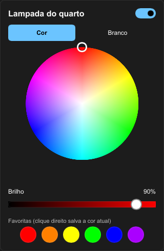
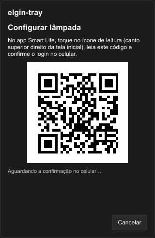
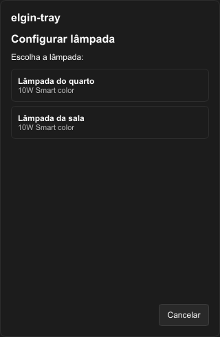

# elgin-tray

[](https://github.com/BrunoNC22/elgin-tray/actions/workflows/ci.yml)

Controle a sua lâmpada **Elgin Smart Color** (Tuya, Wi‑Fi) pela bandeja do sistema, no **Windows** e no
**Linux (KDE Plasma)**, sem abrir o app do celular e sem passar pela nuvem no dia a dia.

<p align="center">
  
</p>

> A primeira versão (v1.0) está em desenvolvimento: acompanhe o
> [Roadmap](https://github.com/BrunoNC22/elgin-tray/issues/45).

## O que ele faz

- **Ícone na bandeja** com o estado da lâmpada: preenchido na cor atual (ligada), só o contorno
  (desligada) ou cinza com um aviso (sem conexão, chave recusada, não configurada).
- **Clique** no ícone abre o painel: liga/desliga, aba **Cor** (disco de cores como no Smart Life),
  aba **Branco** (temperatura quente ↔ fria), brilho de 1% a 100% e **6 cores favoritas** (clique
  aplica; clique direito salva a cor atual).
- **Clique do meio** liga/desliga; **clique direito** abre o menu (favoritas, iniciar com o sistema,
  atualizações, reconfigurar, sair). No KDE, **rolar o mouse** sobre o ícone ajusta o brilho.
- **Atalhos globais** de teclado (configuráveis).
- Lê o estado da lâmpada ao iniciar e acompanha as mudanças feitas por outros apps.
- **Controle 100% local** (protocolo Tuya 3.5 na rede de casa): rápido e funciona sem internet.
- Inicia com o sistema e fica leve na memória.
- **Atualiza sozinho** no Windows (pacotes assinados); no Arch, pelo AUR.

## Instalação

**Windows 10/11:** baixe `elgin-tray-vX.Y.Z-windows-x86_64.zip` na
[última release](https://github.com/BrunoNC22/elgin-tray/releases/latest), extraia o `elgin-tray.exe`
para uma pasta sua (por exemplo `%LOCALAPPDATA%\elgin-tray\`) e rode uma vez. Não precisa de
administrador. A partir daí ele inicia com o Windows e se atualiza sozinho.

**Arch Linux (KDE Plasma 6, Wayland ou X11):**

```sh
yay -S elgin-tray-bin
```

O app avisa quando sai uma versão nova; atualize com `yay -Syu`.

## Configuração inicial

Na primeira vez o painel abre sozinho na tela **Configurar lâmpada**:

<p align="center">
  
  
</p>

1. Digite o **código de usuário** do Smart Life (no app: **Eu → engrenagem → Conta e segurança →
   Código de usuário**).
2. No Smart Life, toque no ícone de leitura (canto superior direito da tela inicial), **leia o QR
   code** do painel e confirme o login no celular.
3. Escolha a lâmpada. Pronto: o app guarda o que precisa e passa a falar direto com a lâmpada pela rede.

A lâmpada precisa estar no app **Smart Life** (o app Elgin Smart não serve para isso). Para movê-la,
**remova-a primeiro no app Elgin Smart** (editar → "Remover dispositivo") e depois pareie no Smart
Life. Sem isso o Smart Life falha com "não foi possível conectar ao Wi‑Fi", mesmo com a senha certa.

Para trocar de lâmpada ou refazer o login: menu do ícone → **Reconfigurar lâmpada**.

## Atalhos globais

Os padrões são:

| Atalho | Ação |
|---|---|
| `Ctrl+Alt+L` | liga/desliga |
| `Ctrl+Alt+Up` / `Ctrl+Alt+Down` | brilho +10% / −10% |
| `Ctrl+Alt+Right` | próxima cor favorita |

Para trocar, edite a seção `[hotkeys]` do `config.toml` (veja onde ele fica em
[Privacidade](#privacidade)) e reinicie o app:

```toml
[hotkeys]
toggle = "Ctrl+Alt+L"
brightness_up = "Ctrl+Alt+Up"
brightness_down = "Ctrl+Alt+Down"
next_favorite = "Ctrl+Alt+Right"
```

Cada atalho é uma ou mais modificadoras (`Ctrl`, `Alt`, `Shift`, `Win`) e uma tecla: `A`–`Z`,
`0`–`9`, `F1`–`F24`, `Up`, `Down`, `Left`, `Right`, `Space`, `Enter`, `Tab`, `Home`, `End`,
`PageUp`, `PageDown`, `Insert`, `Delete`. Deixe vazio (`""`) para desligar um atalho. Se um atalho
for inválido ou já estiver em uso por outro programa, o app avisa e os outros continuam funcionando.

## Solução de problemas

**A lâmpada aparece como "não está respondendo na rede".**
- A lâmpada só usa Wi‑Fi de **2,4 GHz** e precisa estar na **mesma rede (sub‑rede)** do PC. Redes de
  visitantes e "isolamento de clientes" no roteador bloqueiam a comunicação.
- Confira se ela está ligada no interruptor da parede e se aparece online no Smart Life.
- Se o IP da lâmpada mudou, o app procura de novo sozinho. No **Windows**, essa procura precisa que
  o `elgin-tray.exe` esteja liberado no **Firewall** (redes privadas): se o aviso do Windows foi
  negado, libere em *Segurança do Windows → Firewall → Permitir um aplicativo pelo firewall*.

**"A lâmpada recusou a chave."** Acontece quando a lâmpada é pareada de novo (a chave dela muda). O
app tenta buscar a chave nova sozinho pelo login salvo; se não conseguir, use **Reconfigurar
lâmpada** no menu.

**Os atalhos não funcionam.** Outro programa pode estar usando a mesma combinação (o app avisa ao
iniciar). Troque no `config.toml`.

**Onde fica o log?** `%LOCALAPPDATA%\elgin-tray\logs\elgin-tray.log` (Windows) ou
`~/.local/state/elgin-tray/elgin-tray.log` (Linux). O log nunca contém a chave nem o login.

## Privacidade

- **No dia a dia nada sai da sua rede**: o app conversa direto com a lâmpada (TCP 6668, criptografado
  com a chave local dela).
- **Nuvem da Tuya (Smart Life)** só é usada na configuração inicial e para buscar a chave nova se a
  lâmpada for pareada de novo: login por QR code, lista de dispositivos da sua conta e a chave local
  da lâmpada escolhida.
- **GitHub**: o app consulta a última versão publicada ao iniciar e a cada hora.
- O que fica guardado, no `config.toml` (`%APPDATA%\elgin-tray\` no Windows,
  `~/.config/elgin-tray/` no Linux, com permissão só para o seu usuário): ID, nome, chave local e IP
  da lâmpada, a sessão de login da nuvem, as favoritas, os atalhos e a opção de iniciar com o sistema.
  **Não compartilhe esse arquivo.**

## Desenvolvimento

O projeto é um workspace Rust com arquitetura hexagonal; veja [CLAUDE.md](CLAUDE.md) (decisões e
como trabalhar) e [docs/architecture.md](docs/architecture.md).

```sh
cargo build --release        # o executável fica em target/release/
cargo test --workspace
```

Para controlar a lâmpada pelo terminal (útil para testar o protocolo), há o `elgin-tray ctl`:

```sh
elgin-tray ctl status                 # mostra o estado
elgin-tray ctl on | off | toggle
elgin-tray ctl color 240 100 60       # matiz 0-359°, saturação 0-100%, brilho 1-100%
elgin-tray ctl white 50 0             # brilho 1-100%, temperatura 0 (quente) a 100 (fria)
elgin-tray ctl brightness 25          # brilho do modo atual
elgin-tray ctl discover               # procura a lâmpada na rede e salva o IP
elgin-tray ctl watch                  # mostra as mudanças até Ctrl+C
elgin-tray ctl login <código>         # login por QR code no Smart Life
elgin-tray ctl devices                # lista os dispositivos da conta
```

`ELGIN_TRAY_CONFIG` aponta para outro `config.toml` (útil para testar sem mexer no seu). Como
publicar uma versão: [docs/releasing.md](docs/releasing.md).
