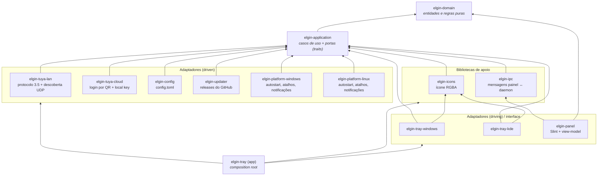
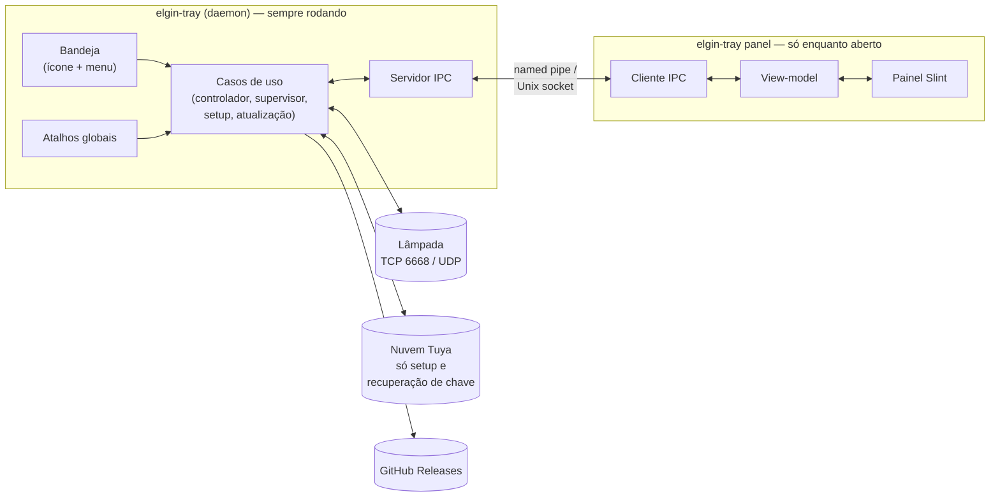

# Arquitetura

O elgin-tray segue a **arquitetura hexagonal** (portas e adaptadores). O domínio e os casos de uso
ficam no centro e não sabem nada de Windows, Linux, Tuya, Slint, TOML ou rede. Tudo que é específico de
um sistema ou de uma tecnologia fica em adaptadores, nas bordas.

## Crates e regra de dependência

Cada camada é uma crate separada no workspace (`crates/`). Como uma crate só enxerga o que declara no
seu `Cargo.toml`, **o compilador garante a regra de dependência**: se o domínio tentar importar algo
de um adaptador, o código não compila.

Regras:

- `elgin-domain` não depende de nada do workspace (`cargo tree -p elgin-domain` mostra só ela).
- `elgin-application` depende só do domínio. Define as **portas** (traits) que os adaptadores implementam
  e expõe os dublês de teste dessas portas na feature `testing`.
- Adaptadores dependem da aplicação e do domínio, **nunca uns dos outros**. Exceções: as bibliotecas de
  apoio `elgin-icons` (usada pelas bandejas) e `elgin-ipc` (usada pelo painel e pelo `app`).
- Só o `elgin-tray` (crate `app`) conhece todas as crates. É ele que escolhe os adaptadores de cada sistema:

  | Sistema | Bandeja | Plataforma |
  |---|---|---|
  | Windows | `elgin-tray-windows` | `elgin-platform-windows` |
  | Linux | `elgin-tray-kde` | `elgin-platform-linux` |

  As crates de um sistema só têm conteúdo naquele sistema (`#![cfg(...)]` no `lib.rs`) e entram no `app`
  por `[target.'cfg(...)'.dependencies]`. Assim `cargo build --workspace` funciona nos dois sistemas.

## Processos

Um único executável, `elgin-tray`, roda em dois papéis:

- O **daemon** é dono da conexão com a lâmpada, do estado e da configuração. Ele fica parado na bandeja
  e precisa ser o mais leve possível.
- O **painel** é aberto pelo daemon quando o usuário clica no ícone (`elgin-tray panel --anchor ...`) e
  termina quando fecha. Ele não fala com a lâmpada: só mostra o estado que recebe pelo IPC e envia as
  intenções do usuário.
- `elgin-tray ctl ...` é uma CLI de desenvolvimento que usa os mesmos casos de uso e adaptadores.

## Fluxo de um comando

Exemplo: o usuário arrasta o slider de brilho no painel.

1. O view-model do painel atualiza a tela na hora (otimista) e envia `Command(SetBrightness)` pelo IPC.
2. O daemon recebe a mensagem e chama o controlador (caso de uso).
3. O controlador aplica a regra do domínio (`BulbState::apply`), publica o novo estado (o ícone da
   bandeja e o painel se atualizam) e, respeitando a coalescência (no máximo um envio a cada ~100 ms),
   pede à porta `BulbGateway` para enviar.
4. O adaptador `elgin-tuya-lan` traduz o comando em DPs, criptografa e envia pela conexão TCP.
5. Se o envio falhar, o controlador volta ao último estado confirmado e publica o erro.
6. Mudanças feitas por outros apps chegam como pushes da lâmpada e seguem o caminho inverso.
